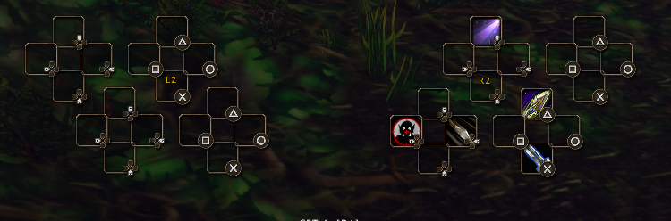
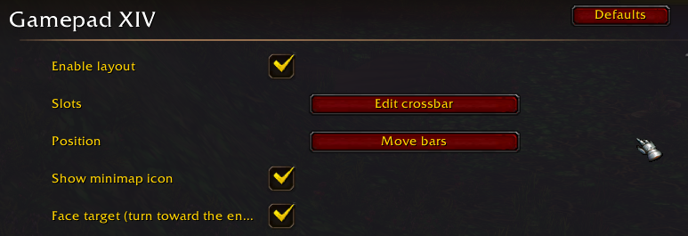
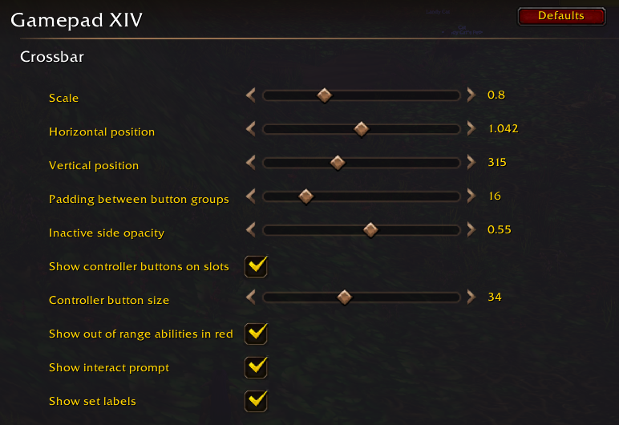
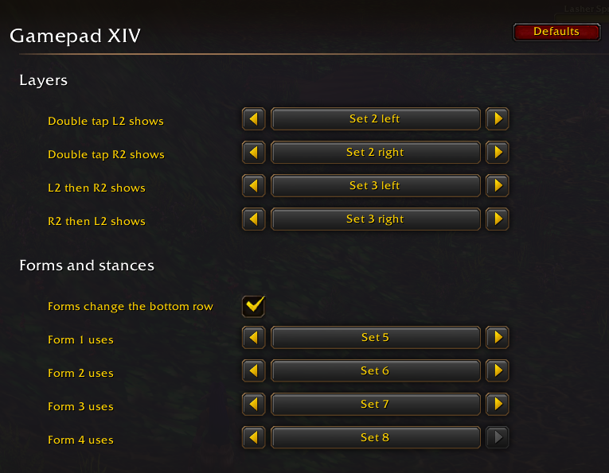
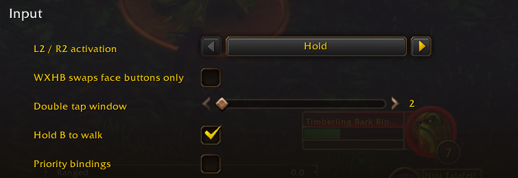

# Gamepad XIV

An FFXIV-style controller layout for WoW Forever (client 1.60.1, Interface 16001).
It runs on top of Forever's Gamepad UI: action slots, interact, cancel, the radial menu and window navigation stay the game's own.
Its double tap timing is adapted from [CrossHotbar](https://github.com/ChainStratagem/CrossHotbar) by ChainStratagem; see [Credits and licenses](#credits-and-licenses).

**Status: early testing, on one character so far.** Confirmed in game: the two rows, bar selection, the interact prompt, skinning, the flyout picker and the spellbook bind. Not yet confirmed: L1 zoom, auto-run and double tap, moving and removing an ability, and face target. See the [in-game checklist](#in-game-checklist).

## Features

- **Two row cross hotbar:** 8 slots per side, with the current set at the bottom and the double tap bars on top, always visible.
- **Bar selection:** hold L2 / R2 for a bottom bar, double tap for a top bar, or L2 then R2 / R2 then L2 for Expanded Hold. Hold, Toggle and Mixed modes are available.
- **8 sets:** R1 + a face button or D-pad direction changes the bottom row, with a `CHANGE SET` overlay.
- **Forms and stances:** each form or stance keeps its own set on the bottom row, including in combat.
- **Selection feedback:** the selected bar grows and glows with a short animation, and the others shrink and dim.
- **Range indicator:** an ability turns red while your target is out of its range. Abilities with no range stay as they are.
- **Controller button art:** optional button icons on every slot, in the style of your controller, plus an original addon icon.
- **Targeting:** enemies and friendlies in turn on D-pad left/right, tab target on R1 + L2 and L1 + R2; camera lock-on on L3; a soft target for party and raid members.
- **Party selection:** double tap L1 or use the D-pad, with the name above the crossbar and a gold outline on the member's frame.
- **Face target:** an optional, experimental setting that turns your character toward the enemy when casting.
- **Camera and movement:** L1 + right stick zoom, L1 + left stick forward auto-run (in either order), hold B to walk, Y / B to ascend and descend, first / third person on R3.
- **Interact prompt:** A / Cross in your controller's art, with the action's icon (loot, talk, skinning, mining, herbalism) and the target's name, over your character (movable) and on nameplates.
- **Flyouts:** spells like Aspect open a controller picker, with each choice on a button and B / Circle to cancel, including in combat.
- **Menus:** map, character, spellbook and inventory on L1 + a face button, with context-sensitive X and A.
- **Editing:** drag and drop directly on the crossbar, plus an edit mode for sets that are not on screen, and a controller flow to move or remove an ability.
- **Layout:** drag each bar anywhere, or all of them together, and set the scale, opacity and the padding between button groups.
- **Minimap icon:** left click for settings, right click for a menu, drag to move it around the minimap.
- **Settings panel and slash commands**, saved per character.
- **Hand-over to Forever:** vehicles, possession and Forever's own bar editor get their normal controls back.

## Screenshots

The crossbar, with the two rows and the controller button art:



Settings:









## Installation

Copy the `GamepadXIV` folder to `Interface/AddOns/`. Turn on the Gamepad UI in game, then enable the addon in the AddOns list. Type `/fc status` to see what is active. After adding or updating files, restart the game rather than only using `/reload`.

The addon needs Forever's Gamepad UI. Without it, the layout stays off and your normal bars are unchanged.

## Crossbar

Two rows are always visible, as in FFXIV: the current set at the bottom and the two double tap bars at the top. The selected bar grows and glows, with D-pad and face button marks in the middle of its groups. The other bars shrink and dim.

| Input | Effect |
|---|---|
| Hold L2 / R2 | bottom bar, left / right |
| Double tap L2 / R2, holding the second press | top bar, left / right, while held; releasing returns to exploration mode |
| Hold L2, then R2 / hold R2, then L2 | Expanded Hold: that bottom side shows another set |
| Hold R1 + Y, B, A, X | set 1, 2, 3, 4 on the bottom row |
| Hold R1 + D-pad up, right, down, left | set 5, 6, 7, 8 on the bottom row |
| R1 + L2 / L1 + R2 | tab target: next / previous enemy |
| L2 / R2 + Back | edit mode |
| L2 / R2 + R3 | move or remove an ability |
| L2 / R2 + Start | settings menu |

**Activation modes**, under `L2 / R2 activation`:

- **Hold:** a bar stays selected while you hold the trigger. Releasing returns to exploration mode, where A, X, Y and the D-pad do their normal jobs.
- **Toggle:** a selected bar stays selected without holding the trigger, including after a double tap. The next press of the same trigger deselects it, and the other trigger replaces it.
- **Mixed:** a quick tap keeps the bar selected until the next press, and holding works like Hold. A double tap is held, as in Hold.

**Forms and stances** change the bottom row, and each one remembers its own set. By default, forms 1-4 start on sets 5-8, which begin empty, so drag abilities onto the bar while in that form. The top row does not change. This can be turned off in the settings.

The keys are the same on every bar. By default, the top row shows set 2 and Expanded Hold shows set 3. Change them in the settings or with `/fc wxhb R 4 L` and `/fc exhb LR 5 R`.

Holding R1 shows `CHANGE SET`, with each set's number where its button is. Choosing set 1-3 also moves Forever's own page to the same number.

## Interact prompt

When something can be used with A / Cross, a large prompt appears over your character: the button in your controller's art, the action's icon (loot, talk, skinning, mining, herbalism, quest objects) and the name. It fades when you are out of range. On units with a nameplate, the button and icon also appear there.

Turn it off with `Show interact prompt`, and move it with the `INTERACT PROMPT` handle in move mode.

## Flyouts

Spells that open a list, such as Aspect, show a panel when you press their slot, including in combat. Each choice has its own button, in this order: A / Cross, X / Square, Y / Triangle, then D-pad up, right, down, left. B / Circle cancels, and you can release the trigger before choosing.

The list shows the highest known rank of each spell, up to 7 choices. It is prepared out of combat, so a spell learned during combat appears afterwards. Clicking the slot with the mouse opens Blizzard's own list.

## Moving or removing an ability

Out of combat, hold L2 or R2 and press R3 (FFXIV uses the touchpad here). A panel asks you to choose the ability: hold L2 or R2, or double tap for the top row, and press its button. The panel then shows the ability and offers:

- **A / Cross: Move.** Choose the new slot the same way. R1 + a button changes the set first if needed. An ability already in that slot swaps with it.
- **X / Square: Remove.** The ability leaves the bar right away.
- **B / Circle: Cancel.**

Entering combat cancels it. It is also on the minimap menu and in `/fc clear`.

## Moving the bars

Use `/fc move` or the `Move bars` button in the editor and the settings. Each bar gets a blue handle you can drag anywhere. `ALL`, or Shift + drag on any bar's handle, moves the whole crossbar. `INTERACT PROMPT` moves the prompt. `Reset` or `/fc reset` puts everything back. Positions are saved per character. Moving only works out of combat.

The gap between the D-pad group and the face button group is set in the settings, under `Padding between button groups`.

## Editing slots

Directly on the crossbar, out of combat:

- Drag a spell, item or macro onto any visible slot, on either row. This works at any time, without edit mode.
- Drag a slot off the bar to move it, even when the bars are locked.
- In the spellbook, the `Bind to Action Bar` button still works and shows this crossbar. Press L2 or R2 + a button. Choosing set 1-3 with R1 also moves Forever's page, so the slot lands on that set. Sets 4-8 are not Forever pages: the slot lands on the page shown at the top, so drag abilities onto those sets instead. The L2+R2 bars of pages 1-3 are sets 4 left, 4 right and 5 left.
- `/fc edit` or L2/R2 + Back opens edit mode. The arrows choose the set shown on the bottom row, and `Expanded` shows the Expanded Hold bars there. In this mode slots do not cast: click picks up or places an action, and right click clears it.

Edit mode turns on the controller's virtual cursor and closes by itself when you enter combat. While the cursor is on, the triggers can act as mouse clicks. Leave with the `Done` button, because Escape does not close the panel.

In the bind window from the spellbook, the bars do not react to your presses and the chosen slot is not highlighted, because the buttons belong to Forever's window. After a `/reload`, press R1 + the set once before binding, so that Forever's page matches. Forms and stances change the set without moving the page, and the top row is not bound directly: for the default top row, choose set 2 and bind there.

## Settings

Open them with `/fc config`, L2/R2 + Start, the minimap icon, or Options > AddOns > Gamepad XIV. Close them with the game's own cancel button.

| Setting | What it does | Default |
|---|---|---|
| Enable layout | turns the crossbar on or off | on |
| Show minimap icon | shows the icon around the minimap | on |
| Edit crossbar / Move bars | open edit mode / move mode; close the settings afterwards to see the crossbar | |
| Face target (turn toward the enemy) | see [Face target](#face-target) | off |
| Scale | size of the whole crossbar (0.5-1.5) | 1 |
| Horizontal / Vertical position | position of the whole crossbar | 0 / 90 |
| Padding between button groups | gap between the D-pad and face button groups (0-80) | 16 |
| Controller button size | size of the button art on the slots (16-60) | 34 |
| Show interact prompt | the button, action icon and target name over your character | on |
| Inactive side opacity | how visible the other bars are while one is selected | 0.55 |
| Show controller buttons on slots | your controller's button art on each slot | off |
| Show out of range abilities in red | tints an ability red while your target is out of its range | on |
| Show set labels | the `L2`, `R2` and `SET` labels | on |
| Double tap L2 / R2 shows | which set and side each top bar shows | set 2 left / right |
| L2 then R2 / R2 then L2 shows | which set and side Expanded Hold shows | set 3 left / right |
| Forms change the bottom row | gives each form or stance its own set | on |
| Form 1-4 uses | the set each form or stance uses | sets 5-8 |
| L2 / R2 activation | Hold, Toggle or Mixed | Hold |
| D-pad arrow selection | Enemies only, Friendly only or Both: what D-pad left / right select | Both |
| D-pad party selection | Off, In a raid or Always: when the whole D-pad moves over the party and raid frames | Off |
| Party targeting | Soft or Hard: whether party selection sets a temporary target or your real target | Soft |
| WXHB swaps face buttons only | keeps the D-pad on the bottom row during a double tap (4 slots) | off |
| Double tap window | window in 0.2 s steps (2-4) | 2 |
| Hold B / Circle to walk | walks while the button is held | on |
| Priority bindings | use only if R2 does not change the bar | off |

## Minimap icon

Left click opens the settings, and dragging moves the icon around the minimap. Right click opens a menu with:

- Edit crossbar, Move bars, Move or remove an ability, and Settings
- Enable layout and Face target
- L2 / R2 activation (Hold, Toggle, Mixed)
- D-pad arrow selection: Enemies only, Friendly only or Both
- D-pad party selection: Off, In a raid or Always
- Party targeting: Soft or Hard
- Reset bar positions and Hide minimap icon

The menu closes on a click elsewhere and when you enter combat. Using the minimap icon with a controller needs the virtual cursor (L1 + R3). The same entry also appears in the minimap's AddOn compartment. If you hide the icon, `/fc minimap` or `Show minimap icon` in the settings brings it back.

## Slash commands

`/gxiv` works the same as `/fc`.

| Command | Effect |
|---|---|
| `/fc status` | shows what is active and the current input CVars |
| `/fc on`, `/fc off` | turns the layout on or off, and `off` restores your input CVars |
| `/fc edit` | edit mode |
| `/fc config` | settings |
| `/fc clear` | moves or removes an ability |
| `/fc move` | moves the bars |
| `/fc reset` | puts the bars back in their default place |
| `/fc wxhb <L\|R> <set> <L\|R>` | the side a double tap shows, for example `/fc wxhb R 4 L` |
| `/fc exhb <LR\|RL> <set> <L\|R>` | the side Expanded Hold shows, for example `/fc exhb LR 5 R` |
| `/fc tap <2-4>` | double tap window, in 0.2 s steps |
| `/fc scale <0.5-1.5>` | crossbar scale |
| `/fc priority on\|off` | priority bindings |
| `/fc minimap` | shows or hides the minimap icon |
| `/fc debug` | reports bindings, CVars and the sticks for 10 seconds |

## Pets

Forever gives hunters and warlocks two round buttons near the bottom of the screen instead of a pet bar, and they stay visible with this addon:

- **L1 + L2** opens the pet commands, and **R1 + R2** opens the pet spells.
- Press both buttons together to open a menu, then aim with the right stick. Any other button press closes it, as in Forever.
- For these two classes, L2 + L1 and R2 + R1 no longer change target. L2 + R1 and R2 + L1 still do.

## Face target

FFXIV turns your character toward the target whenever you use an attack. WoW has no way for an addon to do exactly that, so `Face target (turn toward the enemy)` near the top of the settings is the closest option:

- It locks the camera on your enemy target.
- It makes the character turn with the camera while casting, using `GamePadTurnWithCamera`.
- The result is that your character faces the enemy when you cast.

The client asks you to confirm experimental camera features the first time. The addon remembers your answer: after **Accept** it stops the question from coming back, and **Disable** turns face target and lock-on off until you turn one of them on again. If the client asks while the UI is still loading, the question can appear once more; answer it normally.

**Limitations:** unlike in FFXIV, the camera also moves by itself while you have an enemy targeted. The option relies on an experimental CVar (`test_cameraTargetFocusEnemyEnable`), so it may do nothing on some client versions or disappear later. It is off by default.

## Other controls

| Input | Effect |
|---|---|
| Left / right stick | movement / camera |
| A | Confirm: interact or attack (Forever's button); with a temporary target, makes it the real target |
| B | Cancel; hold to walk; while flying or swimming, descend |
| X | Map; with a target, the target menu |
| Y | Jump; while flying or swimming, ascend |
| D-pad left / right | previous / next target (real target); see `D-pad arrow selection` and `D-pad party selection` |
| D-pad up / down | temporary target through the party, starting with yourself; see `D-pad party selection` |
| L2 or R2 + R1 / L1 | next / previous enemy |
| L1 + L2 | hunters and warlocks: Forever's pet commands (attack, follow and so on) |
| R1 + R2 | hunters and warlocks: Forever's pet spells |
| L1 + left stick forward | auto-run, whichever you press first |
| Double tap L1 | party selection: starts with yourself, and the next double tap moves to the next member |
| L1 + right stick up / down | zoom in / zoom out |
| L1 + R1 | draw / sheathe weapon; on a mount, dismount; while flying, descend |
| L1 + D-pad up / down | tab target: previous / next enemy |
| L1 + D-pad left / right | temporary target through the raid (alliance); in a party, through the party |
| L3 | no target: draw weapon; with a target: camera lock-on |
| R3 | first / third person |
| L1 + R3 | virtual cursor |
| L2 / R2 + R3 | move or remove an ability |
| Start | Forever's radial (main menu) |
| Back | focus on open windows (the closest match to the HUD cycle) |
| L1 + Back / L1 + Start | hide UI / screenshot |
| L1 + A / B / X / Y | character / spellbook / map / inventory (added by the addon) |

FFXIV reference: [Controls](https://ffxiv.consolegameswiki.com/wiki/Controls) and [W Cross Hotbar](https://ffxiv.consolegameswiki.com/wiki/W_Cross_Hotbar). The exact FFXIV double tap timing is not documented there.

**Party selection:** with no L2/R2 held, a double tap on L1 (or D-pad up/down) starts with yourself and steps through the party members. The name appears above the crossbar, and the member's frame gets a gold outline.

**D-pad party selection:** this setting gives the whole D-pad to the party and raid frames on screen, and each direction moves to the frame that way, wrapping at the end of a row or column. The selection is a temporary target. Pressing a direction with no temporary target selects the frame you were last on. `Always` applies everywhere; `In a raid` applies only in a raid, and elsewhere the D-pad works as normal. With no compact frames on screen, it steps through the party list instead. Frames that appear during combat can only be reached after combat. Enemy tab target stays on L1 + D-pad up/down, R1 + L2 and L1 + R2.

**The temporary target (soft target)** is used for party and raid, as in FFXIV: the next ability goes to it, your real target stays unchanged, and after the ability you return to your real target. A confirms it and B cancels it.

**Party targeting:** set it to `Hard` and party selection (D-pad and double tap L1) changes your real target instead, with no temporary target. The name above the crossbar and the gold outline do not appear, and every press moves on from the last frame or member, even if you have targeted something else since.

**Death, resurrection and party invite popups:** Forever does not focus these by itself, so about a second after one appears, the face buttons press its buttons directly, as shown below the popup in your controller's art. For example, A / Cross releases your spirit and Y / Triangle opens the recap. The wait keeps a button press meant for the fight from answering it. Anything that shows up in combat gets this when combat ends.

**Loot rolls:** Forever does not focus the roll window by itself, so press Back with no L2/R2 held, as the prompt below the window shows, then use the buttons it shows, such as A / Cross for Need and B / Circle for Pass. This also works in combat.

L1 on its own does nothing: holding it is a layer, like the triggers, and rotation stops so the right stick only zooms.

**Game settings changed by the addon:** while active, the addon sets `GamePadEmulateShift`, `GamePadEmulateCtrl` and `GamePadEmulateAlt` to `none` and `GamePadStickAxisButtons` to `1`, which saves them to `Config.wtf`. Your original values stay in the addon's data and come back with `/fc off`, or when Forever takes over, for example in a vehicle. If you disable the addon in the AddOns list without `/fc off`, the values stay changed. It also turns off the client's interact icon (`SoftTargetIconInteract`) and the input legend for the session only.

## Differences from FFXIV

- **The double tap window is approximate: normally 0.2-0.4 s, sometimes shorter in combat.** Secure code has no clock and uses a timer that certain events advance. `/fc tap 3` widens it.
- **Enemy cycling is WoW's tab target**, with real targets. Objects are picked up with A through soft interact.
- **`Both` takes turns between enemies and friendlies.** WoW has no tab target over both, and addons cannot tell the units around you apart in combat, so each press alternates WoW's enemy and friend tab targets. With only enemies or only friendlies around, every other press does nothing; `Enemies only` and `Friendly only` avoid that.
- **There is no Enmity list.** WoW does not give addons an aggro list, so L1 + D-pad up/down does tab target.
- **The soft target's target circle** is only the name shown above the crossbar, plus the gold outline on party and raid frames.
- **Abilities are assigned by drag and drop on the crossbar**, not through an FFXIV-style menu. For sets 1-3, Forever's own editor also works (Spellbook, then Y).
- **Forms without a WoW bonus bar (Travel Form, for example) do not change the set**, and abilities on Forever's stance bar are not copied over. Vehicles and possession hand control back to Forever's bar.
- **The client's world icon for interact is off**, because it cannot show the right button. Objects and units without a nameplate use the prompt over your character.
- **The hidden Forever bar still receives mouse clicks** at the bottom of the screen, even though it is invisible.
- **Holding R1 and pressing R2 cancels set selection** until you press R1 again.
- **Face target also moves the camera**, and it and lock-on use an experimental CVar (`test_cameraTargetFocusEnemyEnable`) that may disappear.

## Where abilities are saved

| Sets | Slots |
|---|---|
| 1-3 | Forever pages 1-3, the L2 and R2 bars |
| 4 and 5 left | Forever's L2+R2 bars |
| 5 right - 8 | regular slots 13-68 (bars 2-6) |

Slots 13-68 are shared with keyboard and mouse mode: whatever you put there also appears on those bars.

## Reporting problems

The addon keeps its latest 40 Lua errors, from any addon, and its own blocked actions, in `errorLog` inside `WTF/Account/<account>/<realm>/<character>/SavedVariables/GamepadXIV.lua`. Run `/reload` to write the file, then attach that part to your report.

If something does not respond, run `/fc debug`, follow its message for 10 seconds, and run `/reload`. The results go to `debugLog` in the same file.

If you see "Gamepad XIV has been blocked from an action", choose `Ignore`, and report it with the error log.

**Known issue:** opening the chat with the `/` key can trigger that message, from `SetPreferredGamepadInteractTarget`. The cause is still being investigated. Each blocked action now records, under `tainted` in the error log, which values on that path addon code has written.

## In-game checklist

1. `/fc status` should show `gamepad UI: true` and `active: true`. **If R2 does not change the bar**, run `/fc priority on`: how the addon's bindings rank against Forever's cannot be determined from the Lua source. Then make sure menus and the inventory can still be navigated.
2. No errors at login (`/console scriptErrors 1`).
3. Drag abilities directly onto both rows. Try `/fc edit`, `/fc move` and `/fc config`.
4. Hold R2 and press A: the ability from set 1 is used.
5. Double tap R2, hold, and use several abilities: the top right bar is selected, with the animation. Releasing returns to normal.
6. **Repeat 4 and 5 in combat.** This is the most important test.
7. Open and close the inventory out of combat, then repeat 4. Window navigation must work, and the bars must stay functional.
8. Press D-pad up, then use a heal: it lands on you and your real target does not change. Try D-pad left/right on enemies and friendlies, and tab target on R1 + L2 and L1 + R2.
   Enter a form or stance, including in combat: the bottom row changes, and R1 + a button changes that form's set.
9. L1 alone does nothing. Try L1 + left stick forward (auto-run), L1 + right stick (zoom), double tap L1 (party) and L1 + R1. If something does not work, run `/fc debug` and include its output in your report.
10. Enter combat with edit mode open: the panel closes, slots cast again, and L2 and R2 stop acting as clicks.
11. Hold R2, press L1, and release R2 before L1; then hold R1, press L2, and release R1 before L2. The bars must return to normal. If a bar stays selected, please report it: the client is sending the release to a different key.
12. If a key does nothing, run `/fc status` and include the error message in your report.

## Development

- `tests/sim.lua` runs the real secure snippets in a strict offline environment. Run `lua5.1 tests/sim.lua` from the addon folder. It cannot prove in-game behaviour.
- `tools/make_icon.py` draws `Icon.tga` and needs Pillow. Run it from the addon folder.
- Code that opens or closes Blizzard windows, or Blizzard's menu, can taint Forever's gamepad focus and block its protected calls. The addon's own panels avoid this on purpose.

### Releasing

`.github/workflows/release.yml` packages the addon with the [BigWigs packager](https://github.com/BigWigsMods/packager). A push to `main` only builds a test package, attached to the workflow run. Pushing a version tag publishes it:

```bash
git tag v0.1.0
git push origin v0.1.0
```

The repository needs two settings, under Settings > Secrets and variables > Actions:

- Secret `CF_API_TOKEN`: a CurseForge API token.
- Variable `CURSEFORGE_PROJECT_ID`: the project ID from the CurseForge project page.

## Credits and licenses

Gamepad XIV is released under the BSD 3-Clause License; see `LICENSE`.

Gamepad XIV's double tap timing is adapted from [CrossHotbar](https://github.com/ChainStratagem/CrossHotbar) by ChainStratagem, used under the BSD 3-Clause License. The full license is in `LICENSE-CrossHotbar.txt`. If you play the regular version of WoW, [CrossHotbar on CurseForge](https://www.curseforge.com/wow/addons/crosshotbar) is worth a look.

Gamepad XIV is a separate addon, and is not endorsed by CrossHotbar or its author.
